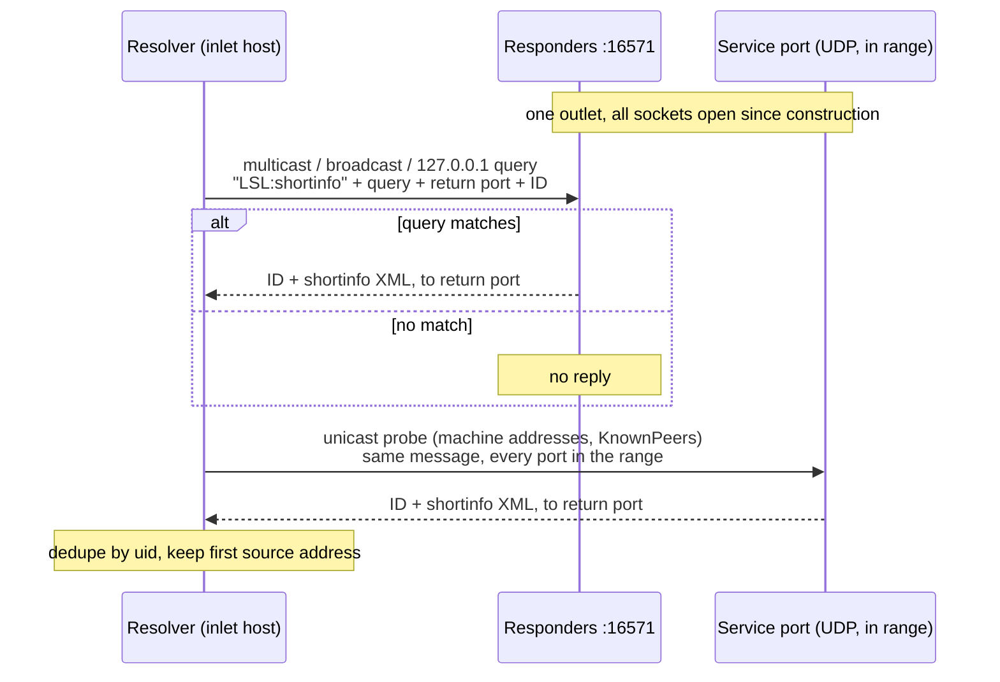
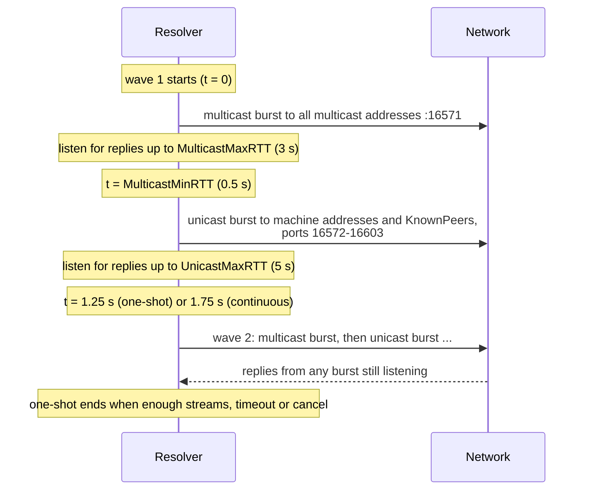

# Stream discovery

Before an inlet can receive data, it has to find the outlet. This step is called
*resolving* or *discovery*. The inlet side sends small UDP queries, and every
outlet whose stream matches the query answers with a short description of itself.
This page describes what goes over the wire, which ports are involved, and how
the timing works.

The code lives in `src/resolver_impl.cpp`, `src/resolve_attempt_udp.cpp`,
`src/resolve_attempt_tcp.cpp` and `src/udp_server.cpp`. Defaults come from
`src/api_config.cpp` (function `load`).

## What an outlet listens on

When an outlet is created (`src/stream_outlet_impl.cpp`, constructor and
function `instantiate_stack`), it opens these sockets once for IPv4 and once for
IPv6, depending on the `ports.IPv6` setting:

- **Multicast responders (UDP).** One socket per address in the multicast
  address list (see [Resolve scopes](#resolve-scopes-and-address-lists)). All of
  them bind to the *multicast port* (default 16571) with address reuse enabled,
  so any number of outlets can share that port. Sockets for multicast addresses
  join their group on every multicast interface. Sockets for broadcast and
  unicast addresses (such as `255.255.255.255` and `127.0.0.1`) only bind. These
  responders answer only `LSL:shortinfo` queries.
- **Service port (UDP).** One socket bound to the first free port in the port
  range. It answers `LSL:shortinfo` queries and `LSL:timedata` clock
  synchronization requests. Its port is published as `v4service_port` /
  `v6service_port` in the stream info.
- **Data port (TCP).** One acceptor bound to the first free port in the port
  range (`src/tcp_server.cpp`). It serves the sample stream (`LSL:streamfeed`),
  the full metadata (`LSL:fullinfo`), and also answers `LSL:shortinfo` queries.
  Its port is published as `v4data_port` / `v6data_port`.

A responder that fails to start (for example because it could not join its
multicast group on any interface) is logged and skipped. The outlet only fails
if neither IP stack could be set up.

### How ports are chosen

The port range is `BasePort` to `BasePort + PortRange - 1`, which is 16572 to
16603 by default. `src/socket_utils.cpp` (function `bind_port_in_range`) tries
each port in that range in order and takes the first one that is not in use.
UDP and TCP ports are separate, so an outlet's UDP service port and TCP data
port often have the same number.

If every port in the range is taken and `ports.AllowRandomPorts` is true (the
default), the socket binds to a port chosen by the operating system. Such an
outlet is still reachable by multicast and broadcast queries on the multicast
port, but not by unicast probes, which only cover the port range. If
`AllowRandomPorts` is false, creating the socket fails instead.

Resolvers draw their reply sockets from the same range, so open outlets and
running resolves on one machine share these 32 ports.

## Defaults and configuration keys

All of these can be changed in the [configuration](../guide/configuration.md).

| Setting | Default | Config key |
|---|---|---|
| Multicast port (UDP) | `16571` | `ports.MulticastPort` |
| First port of the range | `16572` | `ports.BasePort` |
| Number of ports in the range | `32` (16572-16603) | `ports.PortRange` |
| Fall back to OS-chosen ports | `true` | `ports.AllowRandomPorts` |
| IP versions | `allow` (both) | `ports.IPv6` (`disable`, `allow`, `force`) |
| Resolve scope | `site` | `multicast.ResolveScope` |
| Machine addresses | `{127.0.0.1}` | `multicast.MachineAddresses` |
| Link addresses | `{255.255.255.255, 224.0.0.1, 224.0.0.183}` | `multicast.LinkAddresses` |
| Site addresses | `{239.255.172.215}` | `multicast.SiteAddresses` |
| Organization addresses | `{}` | `multicast.OrganizationAddresses` |
| Global addresses | `{}` | `multicast.GlobalAddresses` |
| IPv6 group suffix | `113D:6FDD:2C17:A643:FFE2:1BD1:3CD2` | `multicast.IPv6MulticastGroup` |
| Replace the whole address list | `{}` (unused) | `multicast.AddressesOverride` |
| Replace the TTL | `-1` (unused) | `multicast.TTLOverride` |
| Interfaces for multicast | all interfaces that are up and multicast-capable | `multicast.Interfaces` |
| Responder listen address | wildcard | `multicast.ListenAddress` |
| Unicast peers | `{}` | `lab.KnownPeers` |
| Session ID | `default` | `lab.SessionID` |
| TCP probe discovery | `false` | `lab.ResolveOverTCP` |

## Resolve scopes and address lists

The *resolve scope* decides which addresses queries go to, and how many router
hops (the multicast *TTL*) they may cross. Each scope includes all smaller ones:

| Scope | Addresses added | TTL |
|---|---|---|
| `machine` | machine addresses | 0 |
| `link` | link addresses, `FF02:113D:6FDD:2C17:A643:FFE2:1BD1:3CD2` | 1 |
| `site` (default) | site addresses, `FF05:113D:6FDD:2C17:A643:FFE2:1BD1:3CD2` | 24 |
| `organization` | organization addresses, `FF08:113D:6FDD:2C17:A643:FFE2:1BD1:3CD2` | 32 |
| `global` | global addresses, `FF0E:113D:6FDD:2C17:A643:FFE2:1BD1:3CD2` | 255 |

The IPv6 groups are `FF0x:` followed by `multicast.IPv6MulticastGroup`. If
`AddressesOverride` is not empty it replaces the list; `TTLOverride` (if 0 or
more) replaces the TTL. Finally, addresses of a disabled IP version are dropped.

So with default settings the list is `127.0.0.1`, `255.255.255.255`,
`224.0.0.1`, `224.0.0.183`, `239.255.172.215`, and the `FF02:` and `FF05:`
groups. Outlets listen on this list and resolvers send to it, so both sides
must use compatible settings.

The list mixes three kinds of target. `255.255.255.255` is a *broadcast*
address: every host on the local network segment receives it. `224.x` and
`239.x` (and the `FF0x:` IPv6 addresses) are *multicast* groups: only hosts that
joined the group receive it, and routers may forward it up to the TTL.
`127.0.0.1` is plain *unicast* to the local machine.

## The query and the reply

A UDP query is a text datagram with three lines, each ending in `\r\n`:

```text
LSL:shortinfo
session_id='default' and type='EEG'
16577 11973266323178842010
```

1. The method, `LSL:shortinfo`.
2. The query (see [Query language](#query-language)).
3. The *return port* and the *query ID*, separated by a space. The return port
   is the resolver socket's local port. The query ID is the decimal value of
   `std::hash` of the query string (`src/resolve_attempt_udp.cpp`, constructor).

An outlet that receives this checks the query against its stream info
(`src/udp_server.cpp`, function `process_shortinfo_request`). If it does not
match, the outlet stays silent. If it matches, it sends one datagram to the
query's source address at the return port:

```text
11973266323178842010
<?xml version="1.0"?>
<info><name>...</name><type>EEG</type>...<desc /></info>
```

The first line is the query ID, followed by `\r\n` and the *shortinfo* XML. The
shortinfo is the stream's `<info>` header (`src/stream_info_impl.cpp`, function
`to_shortinfo_message`): `name`, `type`, `channel_count`, `channel_format`,
`source_id`, `nominal_srate`, `version`, `created_at`, `uid`, `session_id`,
`hostname`, the address fields, the four port fields, and an empty `<desc>`.

The resolver ignores replies whose first line is not its query ID. It stores
each stream by its `uid`, so a stream that answers on several addresses counts
once. The outlet does not fill in `v4address` / `v6address`; the resolver sets
them from the reply's source address. The first reply for a stream wins, on the
assumption that it came over the faster route.

Since PR #278 the resolver sends every query from the same socket it receives
replies on. The source port of the query therefore equals the return port.



### Query language

A query is an XPath 1.0 expression. The outlet evaluates it as a boolean with
its `<info>` element as the context node (`src/stream_info_impl.cpp`, function
`query_cache::matches_query`). So `name='BioSemi'` tests the `<name>` child, and
`starts-with(type,'EEG') and channel_count>8` also works. The outlet evaluates
against its full stream info, so paths into `desc` such as
`desc/manufacturer='X'` can match even though the reply's `<desc>` is empty. An
empty query matches every stream on the outlet side. Outlets cache recent results per query string
(`tuning.MaxCachedQueries`, default 100).

The resolver compiles the query before sending and throws
`std::invalid_argument` if it is not valid XPath (`src/resolver_impl.cpp`,
function `check_query`).

The public resolve functions add the session ID: `resolver_impl::build_query`
produces `session_id='<SessionID>' and <predicate>`, or
`session_id='<SessionID>' and <prop>='<value>'`. Because `and` binds tighter
than `or` in XPath, a predicate containing `or` must be wrapped in parentheses
to stay limited to the session. `lsl_resolve_all` sends just
`session_id='<SessionID>'`.

## How a resolve runs

A resolve runs in *waves* (`src/resolver_impl.cpp`, function
`next_resolve_wave`). Each wave:

1. Sends a **multicast burst**: the query to every address in the multicast
   list, at the multicast port.
2. If there are unicast targets, schedules a **unicast burst** after
   `tuning.MulticastMinRTT`. Unicast targets are every address of each
   `KnownPeers` entry, and every machine address, each combined with every port
   in the port range.
3. If `lab.ResolveOverTCP` is on and the previous TCP probe has finished, starts
   a **TCP probe** (see [ResolveOverTCP](#resolveovertcp)).
4. Schedules the next wave.

Each burst creates one socket per allowed IP version, with a reply port from the
port range. A burst sends the full target list once for each local multicast
interface of its IP version, selecting that interface as the outbound interface
first. If that selection fails, the error is logged and sending continues; since
PR #283 a bad interface no longer aborts the resolve. A burst keeps listening
for replies for `tuning.MulticastMaxRTT` (multicast) or `tuning.UnicastMaxRTT`
(unicast), so bursts from consecutive waves overlap.

### Why machine addresses are probed across the port range

Every outlet's responders share the multicast port. A multicast datagram is
delivered to every socket in the group, but a unicast datagram to a shared port
(such as a query to `127.0.0.1:16571`) is delivered to only one of the sockets
bound there. So only one local stream would answer, depending on bind order.
Since PR #282 the resolver also probes the machine addresses on every port of
the range, where each stream's service port is unique. Duplicate targets are
removed before sending.

Because the default machine address list is `{127.0.0.1}`, the unicast burst
runs by default even with no `KnownPeers`. `KnownPeers` entries are probed only
on the port range, never on the multicast port.



### Timing

The gap between waves is `MulticastMinRTT`, plus `UnicastMinRTT` if there are
unicast targets, plus `ContinuousResolveInterval` in continuous mode. With
defaults that is 0.5 + 0.75 = 1.25 s for one-shot resolves and 1.75 s for
continuous ones.

| Key | Default | Meaning |
|---|---|---|
| `tuning.MulticastMinRTT` | 0.5 s | delay before the unicast burst; part of the wave gap |
| `tuning.MulticastMaxRTT` | 3.0 s | how long a multicast burst waits for replies |
| `tuning.UnicastMinRTT` | 0.75 s | added to the wave gap when there are unicast targets |
| `tuning.UnicastMaxRTT` | 5.0 s | how long a unicast burst or TCP probe waits |
| `tuning.ContinuousResolveInterval` | 0.5 s | added to the wave gap in continuous mode |

### One-shot resolves

`resolve_oneshot` (used by `lsl_resolve_all`, `lsl_resolve_byprop`,
`lsl_resolve_bypred`) blocks until one of these happens:

- at least `minimum` streams were found and `minimum_time` has passed,
- the timeout expires, or
- the resolve is cancelled.

The check runs at each wave and after every reply, so a resolve that needs one
stream returns as soon as the first reply arrives. With `minimum` 0, as in
`lsl_resolve_all`, it always runs until the timeout.

### Continuous resolvers

`resolve_continuous` (used by `lsl_create_continuous_resolver*`) runs waves on a
background thread until the resolver is destroyed. Each reply updates the
stream's last-seen time. When `results()` is called, streams not seen for
`forget_after` seconds are dropped (default 5.0 s in the C++ API). Exceptions
inside the background thread are logged and the thread keeps running.

## ResolveOverTCP

`lab.ResolveOverTCP` (default `false`) adds TCP probing for networks that block
UDP discovery (`src/resolve_attempt_tcp.cpp`). The targets are `127.0.0.1`,
`::1` (if IPv6 is allowed) and every `KnownPeers` entry, each combined with every
port in the port range. Up to 16 connections run at once. For each port that
accepts a connection the resolver sends `LSL:shortinfo\r\n<query>\r\n`, with no
return port or query ID. A matching outlet's TCP data server replies with the
bare shortinfo XML and closes the connection; a non-matching one closes without
replying. The address comes from the endpoint that was connected to.

A TCP probe can take long: a filtered port costs a full connect timeout. The
whole probe is cancelled after `UnicastMaxRTT`, and a new one only starts once
the previous one has ended. The library logs a warning when this option is on.

## IPv4 and IPv6

`ports.IPv6` controls both sides: `allow` uses both stacks, `disable` only IPv4,
`force` only IPv6.

- An outlet builds the IPv4 stack, then the IPv6 stack. Each has its own
  responders, service port and data port.
- A resolver opens one socket per allowed stack (IPv6 first) and sends each
  target only from the socket of its family.
- Multicast interfaces come from `multicast.Interfaces` if set, otherwise from
  the operating system (interfaces that are up and multicast-capable, see
  `src/netinterfaces.cpp`). IPv4 interfaces are selected by address, IPv6
  interfaces by interface index.
- A reply over IPv4 fills `v4address`, a reply over IPv6 fills `v6address`.

## What this means for firewalls

On the **outlet** host, allow inbound:

| Protocol | Port(s) | Purpose |
|---|---|---|
| UDP | 16571 (`MulticastPort`) | multicast, broadcast and `127.0.0.1` queries |
| UDP | 16572-16603 (`BasePort` + `PortRange`) | unicast probes, clock sync (`LSL:timedata`) |
| TCP | 16572-16603 | data, full metadata, `ResolveOverTCP` probes |

Multicast also needs group membership (IGMP for IPv4, MLD for IPv6) to work on
the network, and routers must forward the groups if the scope crosses subnets.

On the **inlet** host, allow outbound UDP to 16571 and 16572-16603, outbound TCP
to 16572-16603, and inbound UDP replies to 16572-16603 (the resolver's reply
ports). For unicast queries the reply goes back to the port the query came
from, so a stateful firewall can match it as a reply. For multicast and
broadcast queries the reply comes from the outlet's own address, not from the
address the query was sent to, so a rule for the inbound replies is needed.

Ports outside the range appear only if the range is exhausted and
`AllowRandomPorts` is on. Such sockets get OS-chosen ports that no fixed
firewall rule can cover. The inlet's clock-sync socket also always uses an
OS-chosen port; the outlet's replies come back to it from the outlet's service
port, which a stateful firewall matches to the outgoing probe.
