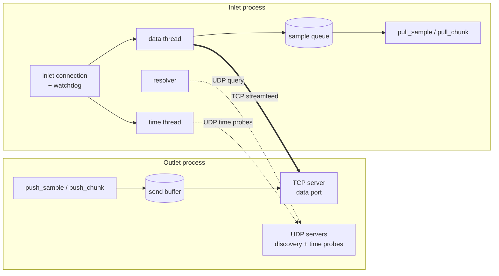
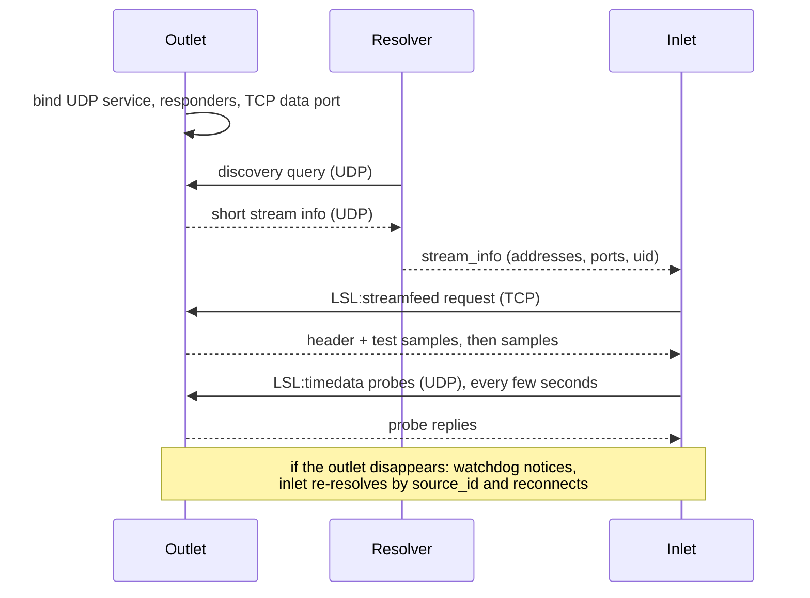

# How liblsl works: overview

This section describes what liblsl does on the network and inside your process. It is for
people debugging connection problems, writing a compatible implementation, or changing liblsl.
For the concepts behind LSL (streams, metadata, synchronization) start with the
{doc}`LSL introduction <lsl:info/intro>`.

## The pieces

| API object | Role | Internal class |
| --- | --- | --- |
| `stream_info` | Describes a stream: name, type, channel count and format, nominal rate, `source_id`, extended XML metadata (`desc`). Outlets also fill in a unique `uid`, host name, session id and ports. | `stream_info_impl` |
| `stream_outlet` | Publishes one stream: answers discovery queries and time probes, and sends samples to every connected inlet. | `stream_outlet_impl` |
| resolver (`resolve_stream(s)`, `continuous_resolver`) | Finds outlets on the network that match a query. | `resolver_impl` |
| `stream_inlet` | Connects to one outlet, receives its samples, keeps the connection alive and measures the clock offset. | `stream_inlet_impl` |

A stream is identified by its `uid`, a random UUID created with the outlet. The
`source_id` set by the application should identify the *data source* (e.g. a device serial
number) and stay the same across restarts; inlets use it to find a restarted outlet
(see [connection recovery](recovery.md)).

## What runs where

**An outlet** starts, for each enabled IP version (IPv4/IPv6):

- a UDP *service* socket on a free port that answers discovery queries sent directly to it and
  time-synchronization probes;
- UDP *responders* on the shared discovery port (16571 by default) that answer multicast and
  broadcast discovery queries;
- one TCP server on a free *data* port that serves stream data, the full stream info and the
  short info.

Two IO threads run these servers (one for data, one for discovery and time). Each connected
inlet gets a session on the TCP server. In the default (asynchronous) mode,
`push_sample` copies the sample into a send buffer, and each session's transfer thread sends it
from its own queue. In synchronous mode (`transp_sync_blocking`) `push_sample` writes to all
connected sockets directly, without a copy.

**A resolver** sends discovery queries in waves over UDP (multicast, broadcast and unicast) and
collects the replies, each of which contains the outlet's short `stream_info` with its
addresses and ports. See [stream discovery](discovery.md).

**An inlet** is a facade over four parts:

- the *connection*, which holds the resolved `stream_info`, tracks whether the outlet is alive
  (a watchdog thread) and re-resolves it when it disappears;
- the *info receiver*, which fetches the full stream info (with `desc`) over TCP on demand;
- the *data receiver*, whose thread opens the TCP streamfeed, parses incoming samples into a
  queue that `pull_sample` / `pull_chunk` read from, and reconnects after errors
  (see [data transport](streamfeed.md));
- the *time receiver*, whose thread exchanges UDP probes with the outlet to estimate the clock
  offset returned by `time_correction()` (see [time synchronization](time_sync.md)).

Threads start lazily: an inlet only connects when you first open the stream, pull data or ask
for its info, and only starts time synchronization on the first `time_correction()` call or when
clock-sync post-processing is enabled.

## Lifetime of a connection

## Configuration

Ports, discovery scope, known peers, IPv4/IPv6, time-probe timing and buffer sizes can be changed
with a configuration file; see [Configuration](../guide/configuration.md).

## Where to look in the code

| Topic | Files |
| --- | --- |
| Public API | `include/lsl_c.h`, `include/lsl/*.h`, `include/lsl_cpp.h` |
| Outlet | `src/stream_outlet_impl.*`, `src/tcp_server.*`, `src/udp_server.*`, `src/send_buffer.*`, `src/consumer_queue.*` |
| Discovery | `src/resolver_impl.*`, `src/resolve_attempt_udp.*`, `src/resolve_attempt_tcp.*`, `src/netinterfaces.*` |
| Inlet | `src/stream_inlet_impl.h`, `src/inlet_connection.*`, `src/data_receiver.*`, `src/info_receiver.*`, `src/time_receiver.*`, `src/time_postprocessor.*` |
| Samples and wire format | `src/sample.*`, `src/portable_archive/`, `src/util/endian.*` |
| Stream info XML | `src/stream_info_impl.*` (pugixml) |
| Configuration | `src/api_config.*`, `src/util/inireader.*` |
