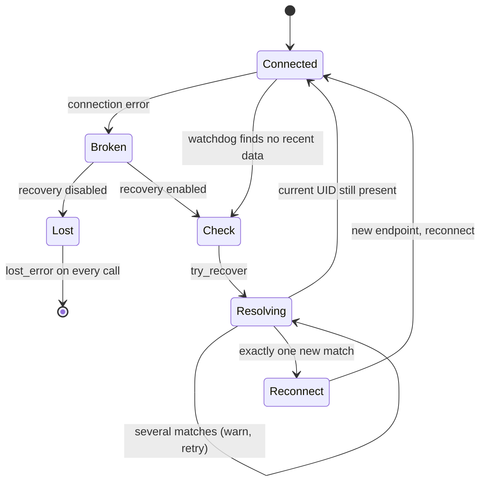

# Connection recovery and failure modes

An inlet keeps a TCP connection to one outlet. That connection can break: the sending program
crashes and restarts, a cable is pulled, a laptop changes networks. liblsl can often repair the
connection on its own. This page explains how that works (part 1) and lists the failure modes
that remain, with what to do about each (part 2).

For general firewall and network troubleshooting, see the main LSL documentation:
{doc}`lsl:info/network-connectivity`. For how streams are found, see
[stream discovery](discovery.md). For the TCP data connection itself, see
[data transport](streamfeed.md). Settings named below are described in
[configuration](../guide/configuration.md).

## Part 1: how inlet recovery works

### Terms

- **UID**: a random ID that an outlet gets when it is created. A restarted outlet gets a new UID,
  even if it has the same name and source ID. See `src/tcp_server.cpp` (constructor, `reset_uid`).
- **source_id**: an optional ID that the application sets on its `stream_info`. It should
  identify the data source (for example a device serial number) and stay the same across
  restarts.
- **Recovery**: finding the stream again on the network and reconnecting to its (possibly new)
  address and ports.
- **Lost**: the inlet has given up. Every later call fails with `lost_error`.

All of the logic lives in `src/inlet_connection.cpp`. The data, metadata and clock receivers of
an inlet (`src/data_receiver.cpp`, `src/info_receiver.cpp`, `src/time_receiver.cpp`) share one
`inlet_connection`.

### When recovery is enabled

The constructor of `inlet_connection` decides this once:

| How the inlet was created | Recovery |
|---|---|
| From a resolved `stream_info`, `recover=true`, non-empty source_id | Enabled |
| From a resolved `stream_info`, `recover=true`, empty source_id | Disabled, with the warning *"can't be recovered automatically if its provider crashes because it doesn't have a unique source ID"* |
| From a resolved `stream_info`, `recover=false` | Disabled |
| From a hand-made `stream_info` (no address) | Always enabled, whatever `recover` says |

### How an inlet notices a broken connection

There are two paths.

1. **An error on the connection.** The data thread (`data_receiver::data_thread`) and the
   metadata thread (`info_receiver::info_thread`) call `try_recover_from_error` when:
   - the socket reports an error (connection refused, reset or closed);
   - the outlet answers the handshake with `404`, which means the address no longer serves the
     UID the inlet asked for (logged as *"likely outdated"*);
   - the UID in the handshake reply does not match;
   - parsing or format checks fail (logged as *"Stream transmission broke off ... re-connecting"*).

   After each attempt the data thread waits 500 ms before it connects again. `close_stream()`
   interrupts this wait.

2. **The watchdog.** A connection can also go quiet without any error. If recovery is enabled,
   `inlet_connection::engage` starts a watchdog thread (`watchdog_thread`). Every
   `WatchdogCheckInterval` seconds (default 15) it checks two things: is any receive thread of
   this inlet running, and has no data arrived for more than `WatchdogTimeThreshold` seconds
   (default 15)? If both are true it calls `try_recover`. The data thread refreshes the receive
   time for every sample on streams up to 16 Hz, and for every 16th sample on faster streams.

   The watchdog does not drop a working connection. If the stream's current UID is still found
   on the network, `try_recover` returns and nothing changes. On a sparse marker stream the
   watchdog therefore just sends a discovery query every 15 to 30 seconds.

### What `try_recover` does

1. It takes the inlet's recovery lock, so only one recovery runs per inlet at a time.
2. It builds a query from the original `stream_info`: `channel_count` and `channel_format`
   always, plus `name`, `type` and `source_id` when they are not empty. The query does **not**
   include the host name, session ID or sampling rate. Recovery can therefore move the inlet to a
   matching stream on another computer.
3. It runs a one-shot resolve (`resolver_impl::resolve_oneshot`) that needs at least one result,
   has **no timeout**, and collects replies for at least 1 s. It blocks until a matching stream
   appears or the resolve is cancelled.
4. It compares the results with the current UID:
   - **Current UID found**: the outlet is still there. Nothing to do.
   - **Exactly one other match**: the inlet adopts its address and ports, cancels all open
     connections of this inlet (so blocked reads wake up), and calls the recovery callbacks. The
     data thread then reconnects to the new address.
   - **Several matches**: liblsl will not guess. It logs *"Found multiple streams with name='...'
     and source_id='...'. Cannot recover unless all but one are closed."* and tries again, with
     at least 5 s per attempt, forever.
5. Unexpected errors are logged as *"A recovery attempt encountered an unexpected error"*. The
   inlet is not marked lost; the next connection error or watchdog tick tries again.

When the data thread starts a recovery, it passes its close flag. `close_stream()` (and inlet
destruction) can then interrupt both the wait for the recovery lock and the resolve.

### What `lost_error` means

`lost_error` means this inlet is finished. It is raised only when recovery is disabled and a
connection error happens: `try_recover_from_error` sets the lost flag, wakes all waiting calls,
and throws. After that, `pull_sample`, `pull_chunk`, `open_stream`, `info` and
`time_correction` all fail with `lost_error`. To continue, resolve the stream again and create a
new inlet.

An inlet with recovery enabled never raises `lost_error`. While it recovers, `pull_sample`
simply returns no sample when its timeout expires.

### What `recover=false` does

- No watchdog thread is started.
- The first connection error makes the inlet lost.
- A connection that dies without an error is not detected (see failure mode 4 below).

Use it when your application wants to handle a lost source itself, for example by asking the
user which stream to use next.

### Inlets from a hand-made `stream_info`

You can create an inlet from a `stream_info` that you built yourself instead of one returned by
a resolver. It must have at least one of name, type or source_id, a non-zero channel count, and a
channel format; otherwise the constructor throws `invalid_argument`. The inlet starts with a dummy
address (`127.0.0.1` / `::1`, port 49999). The first connection attempt fails, which starts a
recovery, and the recovery resolve finds the real stream. Recovery is always on for such an
inlet. Because the query includes the channel count and format, they must match the outlet
exactly. If several streams match, the inlet waits forever with the "multiple streams" warning.

### What changes after a recovery

- **Samples sent during the outage are lost.** The outlet creates a new send queue for each
  connection (`src/tcp_server.cpp`, `new_consumer` in the handshake), so the new connection
  starts with new samples only. Samples already in the inlet's buffer are kept.
- **Clock offset is reset.** The clock receiver switches to the new address, drops its offset,
  and `was_clock_reset()` returns true once. The next `time_correction()` waits for a fresh
  estimate. See [time synchronization](time_sync.md).
- **`info()` is not refreshed.** The full metadata is fetched once per inlet. After a recovery it
  still describes the old outlet instance (old UID, possibly old host).

## Part 2: known failure modes

Each entry lists the symptom, the cause in the code, and what to do. All were checked against
the current `dev` branch.

### 1. The stream is visible, but the inlet fails with `lost_error`

**Cause.** Recovery is disabled because the stream has an empty source_id (or `recover=false`).
A common trigger: the outlet restarted and got a new UID, but the inlet was built from a
`stream_info` resolved earlier. The restarted outlet often binds the same ports, so the inlet
reaches it, gets `404` (`data_receiver::data_thread`), and `try_recover_from_error` declares the
stream lost.

**What to do.** Give every outlet a stable, unique source_id. Or catch `lost_error`, resolve
again, and create a new inlet.

### 2. After the sender restarts, the inlet stalls with no error

**Cause.** More than one stream matches the recovery query, usually because several outlets
share a name and source_id (copied example code, a program started twice). `try_recover`
refuses to pick one and retries forever. The log shows *"Found multiple streams ... Cannot
recover unless all but one are closed."*

**What to do.** Make source_ids unique per data source. Close the duplicates. If several
instances are intended, give each a different source_id, or none (which disables recovery).

### 3. The inlet never recovers; the log shows "Invalid query"

**Cause.** `try_recover` puts name, type and source_id between single quotes without escaping.
A value that contains `'` produces an invalid query. The resolver rejects it, `try_recover` logs
*"A recovery attempt encountered an unexpected error"*, and the data thread retries every
500 ms without success.

**What to do.** Do not use `'` in stream names, types or source_ids.

### 4. After a network interruption the inlet stays silent, but the stream is still listed

**Cause.** The read on the data connection has no timeout, and liblsl does not turn on TCP
keep-alive. If the connection dies without the operating system reporting an error, the read can
block indefinitely. The watchdog does not help here: it only switches endpoints when the old UID
has disappeared, and this outlet is still running. With recovery disabled there is no watchdog
at all, and the inlet never becomes lost either.

**What to do.** Watch for missing data in your application (use pull timeouts). When the stream
goes silent but is still listed, call `close_stream()` and then `open_stream()` (or pull again),
which opens a new connection, or recreate the inlet.

### 5. Recovery waits forever when discovery is broken

**Cause.** The recovery resolve has no timeout (`try_recover` passes `FOREVER`). Recovery uses
the same discovery as everything else, so a firewall, a wrong `ResolveScope`, or a missing
`KnownPeers` entry stops recovery as well. The inlet does not raise `lost_error`; pulls just time
out. This can happen even when the TCP data port is reachable, if UDP discovery traffic is
blocked.

**What to do.** Fix discovery first (see [stream discovery](discovery.md) and
{doc}`lsl:info/network-connectivity`). Use pull timeouts to detect the stall.

### 6. Some streams are not found with `KnownPeers` or `ResolveScope=machine`

**Cause.** Unicast discovery (`KnownPeers` and the machine addresses such as `127.0.0.1`) sends
queries to ports `BasePort` to `BasePort + PortRange - 1` (16572 to 16603 by default), where each
outlet has its own service socket (`src/resolver_impl.cpp`, `resolver_impl` constructor). Each
outlet takes one UDP port in that range per IP version, so two with IPv4 and IPv6. Resolvers also
bind their reply socket in the same range while a query runs (`src/resolve_attempt_udp.cpp`).
When the range is full and `AllowRandomPorts` is true (the default), a new outlet silently takes a
random port (`src/socket_utils.cpp`, `bind_port_in_range_`). Peers that use unicast discovery
never query that port. For streams on the same machine, the only remaining path is the shared
multicast port (16571). A unicast query to that port reaches just one of the sockets bound
there, so only one such stream answers.

**What to do.** Increase `PortRange` on all computers involved: the querying side probes the
range from its own configuration. Close programs that hold outlets you no longer need. Set
`AllowRandomPorts=false` to get an error ("All local ports were found occupied") instead of an
outlet that cannot be found.

### 7. Discovery finds nothing on the network, and nothing is logged

**Cause.** The send completion handler in `resolve_attempt_udp::send_next_query` ignores send
errors without logging them. If the operating system refuses to send discovery packets (for
example a program that has not been granted local network access on macOS), discovery silently
finds only local streams, or none.

**What to do.** Check operating system privacy and firewall settings for the program that
creates the inlet, not just for the terminal it was started from. Test with a packet capture as
described in {doc}`lsl:info/network-connectivity`.

### 8. Gaps in the data with no error

**Cause.** The outlet's per-connection send queue and the inlet's receive queue both drop the
oldest sample when they are full (`src/consumer_queue.h`, `push_sample`). Nothing counts or logs
the drops. The inlet's queue holds `max_buflen` seconds of data (times the nominal rate, or
times 100 for irregular streams, at least one sample). The outlet's queue is the smaller of that
and the outlet's own buffer size. Recoveries add gaps too (see "What changes after a recovery").

**What to do.** Pull often enough, and size `max_buflen` on both ends for the longest pause you
expect. Detect gaps from timestamps, or send a sample counter as a channel.

### 9. Data arrives, but clock sync fails or pulls time out

**Cause.** Clock offsets are measured with UDP packets to the outlet's service port
(`src/time_receiver.cpp`). If a firewall on the sending computer allows the TCP data port but
blocks UDP, no offset is ever measured, and `time_correction()` times out. With the
`proc_clocksync` post-processing flag, the pull that queries the offset waits up to 5 s and then
fails the same way. After a recovery the offset is reset, so this can also start later.

**What to do.** Allow inbound UDP on the `BasePort` range on the sending computer.

### Fixed since the 2026-06 analysis

These problems were found in the same analysis and are fixed. Releases are the first tag that
contains the fix.

| Problem | Fix | Release |
|---|---|---|
| Stateful firewalls dropped discovery replies, because queries left from a different socket than the one that received the replies ("works only with the firewall off") | #278: queries are sent from the reply socket (`src/resolve_attempt_udp.cpp`) | v1.18.0.b3 |
| With `ResolveScope=machine` or `127.0.0.1`, only one local stream was found, and which one changed between restarts | #282: machine addresses are also probed across the port range (`src/resolver_impl.cpp`) | v1.18.0.b3 |
| A multicast interface that cannot be used (VPN, Docker, VirtualBox, Hyper-V) aborted discovery, and could terminate the program through a continuous resolver | #283: a bad interface is logged and skipped; the continuous resolver catches errors and keeps running | v1.18.0.b3 |
| `close_stream()` could block while the inlet was recovering, and reopening a closed inlet was unsafe | #299: close interrupts the recovery wait, the back-off and pending `open_stream()` calls | v1.18.0.b3 |
| Destroying an outlet leaked its IO context, buffers and sample factory (#312) | #313 | Not yet released (on `dev` after v1.18.0.b5) |
| Destroying an outlet with connected inlets could leave transfer threads running past its IO threads | #316 | Not yet released (on `dev` after v1.18.0.b5) |

Failure mode 6 above is what remains of the #282 problem: it no longer happens while every outlet
has a port inside the range.
