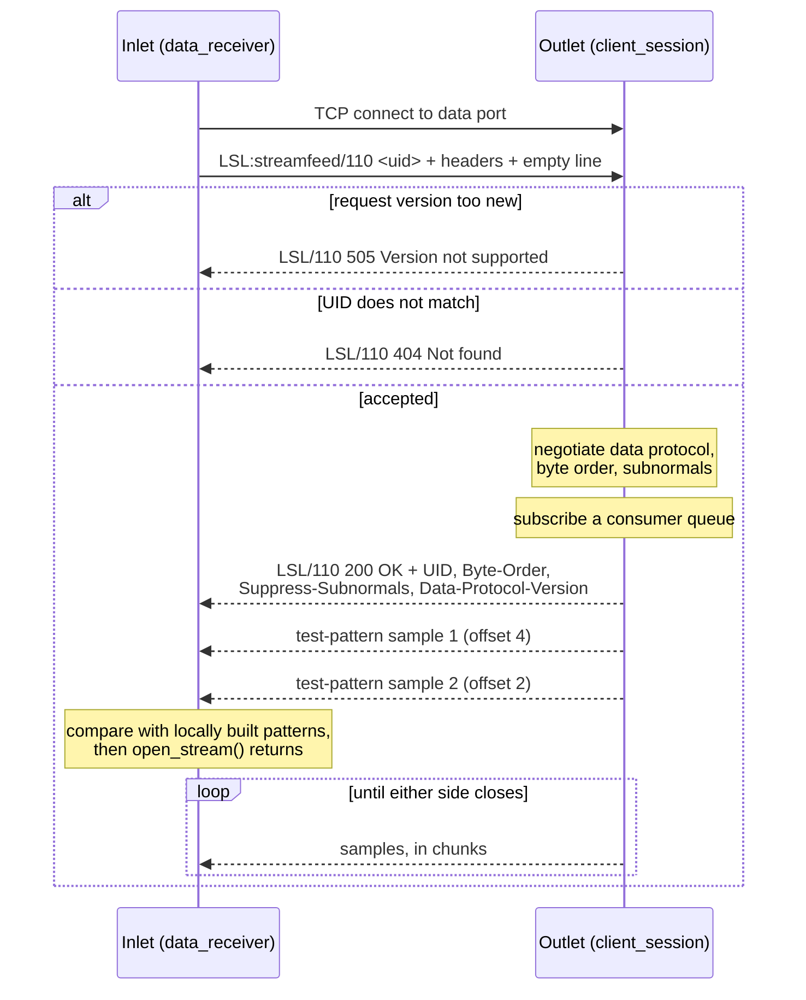
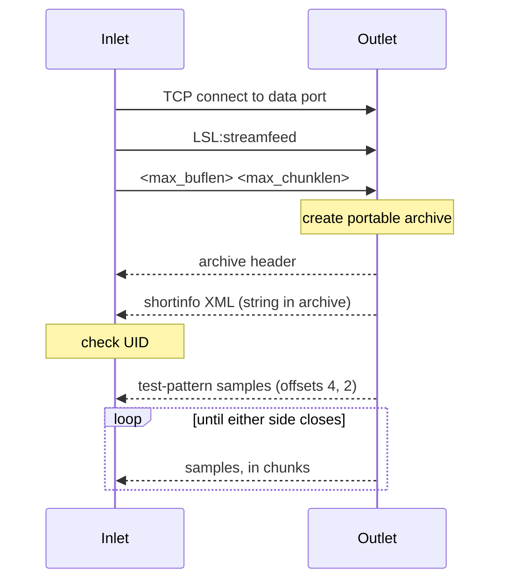
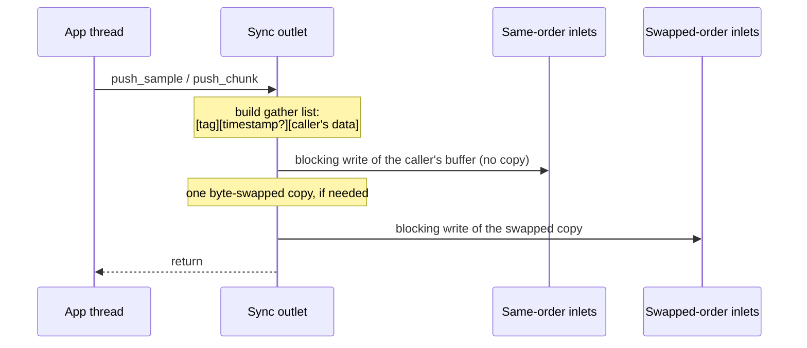

# Data transport (the streamfeed handshake)

This page describes what happens after an inlet has found a stream through
[stream discovery](discovery.md). The inlet opens a TCP connection to the
outlet, the two sides agree on a wire format, and then the outlet sends samples
until one side closes the connection.

Timestamps travel as plain `double` values in the outlet's clock. Converting
them to the inlet's clock is covered in [time synchronization](time_sync.md).

## Overview

Each outlet runs one TCP server (`src/tcp_server.cpp`). It listens on a *data
port*, which the outlet advertises in its stream info as `v4data_port` and
`v6data_port`. Every accepted connection becomes a `client_session`. The first
line the client sends is a *command*. The server understands three:

| Command | Purpose | Client code |
|---|---|---|
| `LSL:streamfeed` or `LSL:streamfeed/<version> <uid>` | Open a data feed | `src/data_receiver.cpp` (function `data_thread`) |
| `LSL:fullinfo` | Fetch the full stream info XML | `src/info_receiver.cpp` (function `info_thread`) |
| `LSL:shortinfo` | Answer a discovery query over TCP | `src/resolve_attempt_tcp.cpp` |

All lines end with `\r\n`. The server ignores any other command and simply
drops the connection (`src/tcp_server.cpp`, function
`handle_read_command_outcome`).

The inlet does not connect when it is created. Its data thread starts on the
first `open_stream()` or `pull_sample()` call. `open_stream()` returns only
after the handshake and the test-pattern check (below) have succeeded.

## Protocol versions

There are two separate version numbers. Both use the form `major * 100 + minor`,
so 1.10 is written `110`.

- The **request protocol version** is the version in the request line. It
  selects the handshake format.
- The **data protocol version** decides how samples are encoded. Version 1.00
  uses a portable archive (see below). Version 1.10 uses a compact raw binary
  format.

The current library version is 110 (`LSL_PROTOCOL_VERSION` in `src/common.h`).
The `[tuning] UseProtocolVersion` setting can lower it; it is capped at 110
(`src/api_config.cpp`). The inlet proposes the smaller of its own configured
version and the `version` field in the outlet's stream info. If that is at
least 110, it sends a 1.10 request. Otherwise it sends a 1.00 request.

## Protocol 1.10 request

The request is a request line, a block of `Key: value` header lines, and an
empty line:

```text
LSL:streamfeed/110 <uid>\r\n
Native-Byte-Order: 1234\r\n
...more headers...\r\n
\r\n
```

`<uid>` is the unique ID of the outlet instance the inlet resolved. The server
parses headers case-insensitively. Text after a `;` is a comment. Lines without
a `:` are ignored. These are the headers the inlet sends
(`src/data_receiver.cpp`, function `data_thread`) and how the outlet uses them
(`src/tcp_server.cpp`, function `handle_read_feedparams`):

| Header | Meaning | Server default if missing |
|---|---|---|
| `Native-Byte-Order` | Inlet byte order: `1234` little endian, `4321` big endian | `1234` |
| `Endian-Performance` | How fast the inlet can byte-swap (number of 64-bit swaps in about 10 ms) | `0` |
| `Has-IEEE754-Floats` | `1` if the inlet's `float` and `double` are IEEE 754 | `1` |
| `Supports-Subnormals` | `1` if the inlet's platform supports subnormal numbers for this channel format | `1` |
| `Value-Size` | Bytes per channel value on the inlet; `0` for string streams | the outlet's own value size |
| `Max-Buffer-Length` | Most samples the outlet should queue for this inlet | `0` |
| `Max-Chunk-Length` | Most samples per network write; `0` lets the outlet decide | `0` |
| `Data-Protocol-Version` | Data protocol the inlet proposes | not read (see note) |
| `Hostname`, `Source-Id`, `Session-Id` | Copied from the resolved stream info | not read |

Note: the server looks for a header called `Protocol-Version`, not
`Data-Protocol-Version`. In practice the inlet's data protocol proposal is
therefore taken from the request line.

## Protocol 1.10 response

If the request is accepted, the outlet answers with a status line and headers:

```text
LSL/110 200 OK\r\n
UID: <uid>\r\n
Byte-Order: 1234\r\n
Suppress-Subnormals: 0\r\n
Data-Protocol-Version: 110\r\n
\r\n
```

| Header | Meaning |
|---|---|
| `UID` | The outlet's unique ID. The inlet aborts if it differs from the one it asked for. |
| `Byte-Order` | Byte order of all binary values that follow. The inlet byte-swaps if it differs from its own. `0` is read as "native" for compatibility with liblsl around 1.13. |
| `Suppress-Subnormals` | `1` tells the inlet to flush subnormal floats to zero while reading. |
| `Data-Protocol-Version` | The negotiated data protocol, `100` or `110`. |

The status line always carries the outlet's configured protocol version, not
the negotiated one. The inlet rejects the response if that major version is
newer than its own, or if `Data-Protocol-Version` is higher than its configured
version.



## Negotiating the data protocol

The outlet starts with the smaller of its configured version and the inlet's
request version. It then falls back to 1.00, the portable format, if any of
these hold:

- The stream is numeric and the inlet's `Value-Size` differs from the outlet's
  value size.
- The outlet's `double` is not IEEE 754, or the stream is `float32` and the
  outlet's `float` is not IEEE 754.
- The inlet sent `Has-IEEE754-Floats: 0`.

Byte order and subnormal handling are only negotiated for 1.10. With 1.00 the
response always reports the outlet's native byte order and
`Suppress-Subnormals: 0`, because the portable format does not depend on byte
order.

### Who converts byte order

Byte order (*endianness*) is the order in which the bytes of a multi-byte
number are stored. The outlet converts to the inlet's byte order only if all of
these are true:

1. The two byte orders differ.
2. Both are plain little or big endian (`src/util/endian.hpp`, function
   `can_convert_endian`).
3. Values are wider than one byte. String streams send `Value-Size: 0`, so the
   outlet never converts for them.
4. The outlet measured a higher swap speed than the inlet reported
   (`src/util/endian.cpp`, function `measure_endian_performance`).

Otherwise the outlet sends in its native order and announces that in
`Byte-Order`. The inlet then swaps timestamps, values and string lengths while
reading. The idea is that the faster machine does the work.

### Subnormal suppression

*Subnormal* (denormal) numbers are tiny floating-point values very close to
zero. Some platforms do not support them. If the stream is `float32` or
`double64`, the outlet's platform has subnormals, and the inlet sent
`Supports-Subnormals: 0`, the outlet answers `Suppress-Subnormals: 1`. The
inlet then replaces each subnormal value with a zero of the same sign while
reading (`src/sample.cpp`, function `load_streambuf`). The outlet sends the data
unchanged.

## Protocol 1.00 request

The 1.00 request has no headers and no status line:

```text
LSL:streamfeed\r\n
<max_buflen> <max_chunklen>\r\n
```

The two numbers mean the same as `Max-Buffer-Length` and `Max-Chunk-Length`.
The outlet does not check a UID here. Instead it writes a portable archive
that starts with the outlet's shortinfo XML. The inlet parses it and drops
the connection if the UID differs from the resolved one.



The *portable archive* (`src/portable_archive/`) is a small serializer. It
starts with a magic byte and an archive version. Integers are written as a
size-and-sign byte followed by only the significant bytes, in little-endian
order. Floats are written through their IEEE 754 bit pattern. This makes the
format independent of byte order, at the cost of extra CPU work per value.
Each sample is a tag, an optional timestamp, and the channel values, as in 1.10.

## Test-pattern samples

Right after the handshake, the outlet sends two test-pattern samples. The
inlet builds the same two samples locally and compares them byte for byte. If
they differ, it reports "The received test-pattern samples do not match the
specification" and reconnects. This catches byte-order, value-width, sign and
framing mistakes before any real data is delivered.

The patterns come from `src/sample.cpp` (function `assign_test_pattern`). They
are built with offsets 4 and then 2:

- The timestamp is `123456.789`, sent as an explicit timestamp.
- Channel `k` holds `k + base + offset`. Odd channels are negated.
- The base is chosen so the values need the full width of the type: `0` for
  `float32`, `16777217` (2^24 + 1, which a `float` cannot hold exactly) for
  `double64`, `1` for `int8`, `257` for `int16`, `65537` for `int32`, and
  `2147483649` for `int64`. Integer values wrap at the type's maximum.
- String channels hold `"10"`, `"-11"`, `"12"`, ... The offset is not used, so
  both string samples are the same.

## Sample format for data protocol 1.10

Each sample is written by `src/sample.cpp` (function `save_streambuf`) and read
by `load_streambuf`. There is no per-sample length or channel count; both
sides know the channel count and format from the stream info. All multi-byte
values use the byte order announced in `Byte-Order`.

| Field | Size (bytes) | Present when | Content |
|---|---|---|---|
| Tag | 1 | always | `1` = deduced timestamp, `2` = transmitted timestamp |
| Timestamp | 8 | tag is `2` | `double`, seconds in the outlet's clock |
| Values (numeric) | channel count x value size | numeric streams | values back to back; value size is 1, 2, 4 or 8 |
| Length size (per string) | 1 | string streams | number of bytes in the length field that follows |
| Length (per string) | 1, 4 or 8 | string streams | string length in bytes |
| Characters (per string) | length | string streams | raw bytes, no terminator |

For example, a 2-channel `float32` sample with a timestamp takes 1 + 8 + 8 = 17
bytes. The same sample with a deduced timestamp takes 9 bytes.

The writer picks a 1-byte length for strings up to 255 bytes, a 4-byte length up
to 2^32 - 1 bytes, and an 8-byte length beyond that. The reader also accepts a
2-byte length. So the string `"10"` is sent as `01 02 31 30`.

### Deduced timestamps

A *deduced* timestamp means "not sent; work it out". `push_chunk` stamps only the
first sample of a chunk and marks the rest as deduced (`DEDUCED_TIMESTAMP`,
which is `-1.0`). The inlet fills them in: the previous sample's timestamp plus
`1 / nominal_srate`, or the previous timestamp unchanged for irregular-rate
streams.

## Buffering and chunking

### Buffer sizes

The user passes `max_buflen` to the inlet. By default it is in seconds. It is
converted to samples before it goes on the wire
(`src/stream_info_impl.cpp`, function `calc_transport_buf_samples`):

- With a nominal rate: `rate x max_buflen`.
- With an irregular rate: `100 x max_buflen`.
- With `transp_bufsize_samples`: the value is already in samples.
- With `transp_bufsize_thousandths`: the result is divided by 1000.
- The result is at least 1.

The outlet's own buffer size (`max_buffered`, 360 seconds by default in the C++ API)
is converted the same way. That sample count caps
every per-inlet queue (`src/send_buffer.cpp`, function `new_consumer`).

### Queues on both sides

The outlet keeps one *send buffer* (`src/send_buffer.cpp`). Each data
connection subscribes a *consumer queue* to it (`src/consumer_queue.h`). Its
capacity is the smaller of `Max-Buffer-Length` and the outlet's buffer size. Each
pushed sample is added to every queue. When a queue is full, the oldest sample
is dropped silently. A slow inlet therefore loses old data but never blocks
the outlet. The queue is subscribed before the handshake is sent, so samples
pushed during the handshake are not lost.

The inlet has a second consumer queue of `max_buflen` samples between the
network thread and `pull_sample()`. It also drops the oldest sample when full.

### Chunking

Each data connection has its own transfer thread (`src/tcp_server.cpp`,
function `transfer_samples_thread`). It takes samples from the queue and
serializes them into a buffer. It sends the buffer when either:

- the sample has the *pushthrough* flag set, or
- the chunk has reached its maximum length.

`push_sample` sets pushthrough by default. `push_chunk` sets it only on the
last sample. The maximum chunk length is the inlet's `Max-Chunk-Length` if it is
non-zero, otherwise the TCP server's chunk size. Note: in current code the
outlet passes its buffer size in samples as the server's chunk size, so the
outlet's own `chunk_size` argument has no effect
(`src/stream_outlet_impl.cpp`, outlet constructor).

After the handshake the feed is one-way. The outlet keeps a 1-byte read pending
on the socket. If that read completes (the inlet closed the connection or sent
something), the outlet ends the transfer and removes the consumer queue.

A request with a buffer length of 0 gets only the handshake and test patterns;
the outlet then stops. The code notes this is kept for unit tests.

## Synchronous (zero-copy) outlets

An outlet created with the `transp_sync_blocking` flag (in
`include/lsl/common.h`) skips the send buffer and transfer threads. String
streams cannot use this mode. `push_sample` and `push_chunk` write straight to
every connected socket and return only when all writes are done
(`src/stream_outlet_impl.cpp`, functions `enqueue_sync` and `flush_sync`).



- The handshake is the same as for 1.10. After it, the socket is handed to a
  `sync_write_handler` (`src/tcp_server.cpp`). It sorts sockets into a
  same-byte-order group and a swapped group.
- The wire format is the 1.10 sample format above.
- Pushthrough and chunk sizes are ignored. Every push is sent immediately.
- There is no queue, so nothing is dropped. A slow inlet slows the pushing
  thread instead. `[tuning] SyncSendTimeout` limits how long one send may
  block. Its default is `WatchdogTimeThreshold` (15 s). `0` means block forever.
  An inlet that exceeds it is disconnected.
- Pushes must come from one thread at a time.

Synchronous outlets only support data protocol 1.10. A 1.10 request that would
fall back to 1.00 gets `505 Synchronous outlet requires data protocol 1.10`. A
1.00 request is closed without a reply. In both cases the inlet keeps retrying.

## The other commands

**`LSL:fullinfo`**. The outlet replies with its full stream info XML,
including the `<desc>` metadata, and then closes the connection. The inlet
reads until end of stream and parses the XML. If the result has no
`created_at` value, it tries again. This is what `stream_inlet::info()` uses.

**`LSL:shortinfo`**. The client sends a second line with a query string, for
example `name='EEG'`. If the stream matches, the outlet replies with its short
stream info XML (without `<desc>`) and closes. If it does not match, the outlet
closes without a reply. The same command exists over UDP for normal discovery;
see [stream discovery](discovery.md).

Both replies are built once when the outlet starts serving
(`src/tcp_server.cpp`, function `begin_serving`).

## Errors and status codes

The outlet sends these status lines (1.10 requests only):

| Status | When | Inlet reaction |
|---|---|---|
| `200 OK` | Request accepted | Continue with the handshake |
| `404 Not found` | The UID in the request is not this outlet's UID (the stream info is out of date) | Recovery, without an error log |
| `505 Version not supported` | The request's major version is newer than the outlet's | Error logged, then recovery |
| `505 Synchronous outlet requires data protocol 1.10` | See above | Error logged, then recovery |

The inlet treats any other `4xx` or `5xx` code like `505`, and any `3xx` code
like `404`. Without a status line (1.00, or a dropped connection), problems
show up as a closed socket or a failed UID or test-pattern check.

All of these failures end in the same place (`src/data_receiver.cpp`,
function `data_thread`). The data thread calls the connection's recovery logic
(`src/inlet_connection.cpp`, function `try_recover_from_error`), waits 500 ms,
and connects again. If the inlet was created with recovery enabled, recovery
re-resolves the stream, which picks up a new UID and port if the outlet was
restarted. If recovery is disabled, the stream is marked lost and the next
`pull_sample()` throws `lost_error`.
