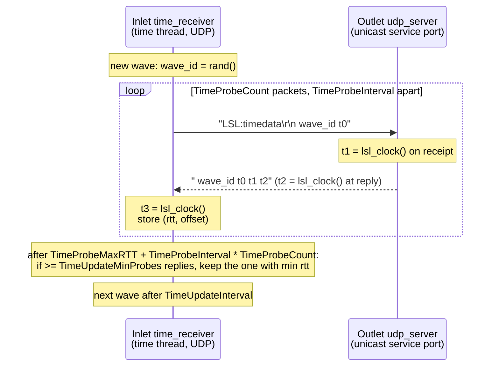

# Time synchronization

Every LSL sample carries a timestamp from the clock of the machine that pushed it.
To compare samples from different machines, an inlet must know how far the
remote clock is from its own. This page describes how liblsl measures that
offset, how accurate the measurement is, how offsets turn into synchronized
timestamps, and how the inlet can do that for you.

liblsl does not synchronize anything by default: it provides the timestamps and
the offset measurements, and leaves it to the application (or a recorder and
importer) to combine them. For how to get synchronized data in practice (online
processing, recording with LabRecorder, importing XDF files, clocks outside
LSL), see {doc}`lsl:info/time_synchronization`.

## The local clock

`lsl_local_clock()` (C) and `lsl::local_clock()` (C++) return the current time
in seconds as a `double`. The same value is used internally as `lsl_clock()`.

The implementation is the same on every platform: `src/common.cpp` (functions
`lsl_local_clock_ns` and `lsl_local_clock`) reads `std::chrono::steady_clock`.
`steady_clock` is a monotonic clock: it never jumps backwards and is not
adjusted by NTP or by the user changing the time of day. The C++ standard
library maps it to the platform's monotonic counter (for example
`QueryPerformanceCounter` on Windows, `CLOCK_MONOTONIC` on Linux).

Two consequences follow:

- The zero point is arbitrary (often the time the machine booted). The value
  says nothing about the time of day.
- Clocks on two machines have unrelated zero points and drift slowly against
  each other. Comparing them needs the offset measurement below.

The nanosecond count is split into whole seconds and a remainder as integers
before converting to `double`, so large uptimes do not lose sub-microsecond
precision.

## Who does what

- **Outlet side.** Each outlet runs a unicast UDP server on a free port in
  the range starting at `BasePort` (`src/udp_server.cpp`). Besides answering
  `LSL:shortinfo` discovery queries, it answers time probes (`LSL:timedata`).
  The multicast/broadcast responders on port 16571 do *not* answer time probes;
  their time service is disabled.
- **Inlet side.** Each inlet owns a `time_receiver` (`src/time_receiver.cpp`).
  It opens one UDP socket and sends probes to the outlet's unicast UDP port.
  It sends and receives on that same socket.

The `time_receiver` thread does not exist until the first call to
`time_correction()`, either by your code or by the `proc_clocksync`
post-processing option. Once started, it keeps measuring until the inlet is
destroyed.

## The probe exchange

One measurement round (a "wave") is a short burst of probe packets. Each wave
gets a random `wave_id` so that late replies from an earlier wave are ignored.

1. The inlet sends a datagram with the text `LSL:timedata\r\n<wave_id> <t0>\r\n`,
   where `t0` is its local clock when building the packet
   (`time_receiver::send_next_packet`).
2. The outlet's UDP server takes `t1` from its own clock as soon as the packet
   is received, before parsing it (`udp_server::handle_receive_outcome`).
3. It replies with ` <wave_id> <t0> <t1> <t2>`, where `t2` is its clock when
   building the reply (`udp_server::process_timedata_request`). The reply has
   no method header; it starts with the wave id.
4. The inlet reads its clock as `t3` on receipt
   (`time_receiver::handle_receive_outcome`). Replies with a different
   `wave_id` are dropped.
5. Same-clock detection (`TimeSameClockDetection`): a newer outlet appends a
   fifth token, the identity of its clock (`lsl_clock_id()`: boot id plus time
   namespace on Linux, `kern.bootsessionuuid` on macOS, MachineGuid plus boot
   time on Windows, sent as their 64-bit FNV-1a hash in 16 hex digits so that
   no machine identifiers go on the wire). If it equals the inlet's own and `t0 <= t1 && t2 <= t3`,
   that probe counts as `rtt = offset = 0`. Older peers ignore or omit the
   token. Other implementations must only send it if their clock is the same
   OS monotonic clock that liblsl's `std::chrono::steady_clock` uses.
6. Fallback for older outlets, which send no token
   (`TimeSameClockFallbackRounds`, `same_clock_fallback`): if the outlet's
   time service address is loopback or one of this machine's interface
   addresses, and every reply of `TimeSameClockFallbackRounds` (3) waves in a
   row is tokenless with `t0 <= t1 <= t2 <= t3` (`|offset| <= rtt/2`), the
   inlet reports offset 0. Any other wave resets the count. Distinct
   `steady_clock`s are boot-relative and differ by seconds or more, so they
   fail at once; a wrong match is still bounded by the probe's offset interval
   `[t2 - t3, t1 - t0]`, and the reported uncertainty stays the measured `rtt`.

So `t0` and `t3` come from the inlet's clock, and `t1` and `t2` from the
outlet's clock. All numbers are sent as text with 16 significant digits.

For each reply the inlet computes:

```text
rtt    = (t3 - t0) - (t2 - t1)          # round-trip time minus outlet's processing time
offset = ((t1 - t0) + (t2 - t3)) / 2    # outlet clock minus inlet clock
```

It also stores the midpoints `(t0 + t3) / 2` (local) and `(t1 + t2) / 2`
(remote) of that probe.

The offset formula assumes the trip there and the trip back take equally
long. If they do not, the result is off by half the difference (see
[accuracy](#accuracy-of-the-offset) below).



## Choosing the estimate

`time_receiver::start_time_estimation` starts a wave and sets two timers:

- **Aggregation**, after `TimeProbeMaxRTT + TimeProbeInterval * TimeProbeCount`
  seconds (0.128 + 0.064 × 8 = 0.64 s with defaults). Then
  `time_receiver::result_aggregation_scheduled` looks at the replies collected
  so far.
- **Next wave**, after `TimeUpdateInterval` seconds (2 s by default),
  measured from the start of the current wave, but never before the
  aggregation.

At aggregation time:

- If fewer than `TimeUpdateMinProbes` replies arrived, the wave is discarded.
  The previous estimate (if any) stays in place.
- Otherwise the reply with the **smallest RTT** wins, as in the NTP clock
  filter. A small RTT means the packets were least delayed, so the offset is
  least affected by queueing. The inlet then stores:
  - the time correction = minus that reply's `offset` (inlet clock minus outlet
    clock, the value you *add* to a remote timestamp);
  - the uncertainty = that reply's `rtt`;
  - the remote time = that reply's remote midpoint `(t1 + t2) / 2`.

`TimeProbeMaxRTT` is not a filter. No reply is rejected for its RTT. It only
sets how long the inlet waits for replies before aggregating. Replies that
arrive after aggregation are not used.

## Accuracy of the offset

The measurement is correct if the network delay is the same in both directions.
Any difference between the outbound and return travel times biases the offset by
half that difference. On a local network the difference has two parts:

- **Random delays** from thread scheduling, buffering and interrupts. Keeping only
  the probe with the smallest round-trip time (the NTP "clock filter") makes it
  likely that the chosen probe was barely affected by them.
- **A constant difference** between the two machines' network stacks (for example
  Linux and Windows). The clock filter cannot remove it, so it dominates the
  remaining error. On modern hardware and operating systems it is usually well
  below a millisecond.
  Receive interrupt coalescing on a network adapter is one cause; see
  [clock offset accuracy](../guide/clock_accuracy.md).

The round-trip time of the chosen probe is reported as the `uncertainty` of
`time_correction()`: the true offset is within that bound. Measurements of LSL's
end-to-end synchronization accuracy are collected in the
[LSL validation results](https://sccn.ucsd.edu/download/mgrivich/LSL_Validation.html).

## From offsets to synchronized timestamps

An offset is measured every `TimeUpdateInterval`, and the clocks drift slowly
between measurements. There are increasingly accurate ways to map a remote
timestamp into the local clock:

1. Add the most recent offset. This is what `proc_clocksync` does, and it is
   usually enough for online processing: the error from the offset is small
   compared to the jitter in the raw timestamps.
2. Fit a straight line through the history of offsets and map each timestamp
   through it. This models a constant clock drift.
3. Use a robust (outlier-resistant) line fit, so a few bad measurements don't
   tilt the mapping.

### Drift compensation (opt-in)

With `[tuning] TimeDriftWindow` set to a number of seconds (0, the default,
turns it off), the inlet does a robust version of option 2 itself
(`src/drift_estimator.h`). It keeps the chosen `(local time, correction, rtt)`
of each wave from the last `TimeDriftWindow` seconds (at most 256 waves), fits
a Theil-Sen line to them (slope = median of all pairwise slopes, intercept =
median of the residuals) after every wave, and `time_correction()` returns that
line evaluated at the current `lsl_clock()`. That removes the lag of holding a
measurement for up to `TimeUpdateInterval` (at 20 ppm relative drift, 40 µs
just before the next wave) and averages out the per-wave noise. Single bad
waves barely move a median fit. Guard rails:

- Until the window holds 5 waves spanning at least 6 s, or if the fitted slope
  exceeds 500 ppm, the latest wave is returned, exactly as without the option.
- A median line ignores a change in the clock rate (for example an NTP
  frequency correction on Linux, where `steady_clock` is slewed) for half a
  window. So when at least 3 consecutive waves, spanning at least 3 s, miss
  the line on the same side by more than max(5 σ, 30 µs) + (rtt − smallest
  rtt in the window) / 2, where σ is the robust spread of the fit residuals,
  the waves before the first miss are dropped and the fit starts again. The
  rtt term allows for waves that arrived with extra delay (which may be off by
  up to half of it). Shorter excursions are left to the median: between macOS
  and Linux, pairs of waves over a faster path, 50–60 µs off, came every few
  minutes, and a two-wave rule reset the fit on each of them.
- Pairs of waves less than 0.25 s apart are left out of the slope.
- The history is cleared when the inlet recovers
  (`reset_timeoffset_on_recovery`) and while same-clock detection reports 0.

`remote_time` and `uncertainty` still describe the most recent wave's chosen
probe, not the fit.

Measured on wired LANs (macOS, Linux, Windows 10; logged probe rounds replayed
through the estimator offline): with a
60 s window the error of the returned correction against a non-causal reference
fell from 11 µs to 3 µs (median) and from 53 µs to 14 µs (95th percentile) at
the default 2 s update interval, and the step between consecutive post-processor
queries from 66 µs to 18 µs (99th percentile). Against PTP ground truth (Linux
pair, 30 min) the error after removing its constant part fell from 1.4 µs to
0.6 µs (95th percentile). It does nothing for the constant asymmetry described
above (about 30 µs on that pair), which is usually the larger error. The price
is the reaction to a sudden clock rate change: a synthetic 10 s, 50 ppm rate
excursion gave up to about 420 µs of error, above 100 µs for about 16 s, versus
about 130 µs for 2 s without the option; no such change occurred in the 30 min
recordings. Short clock jerks of 16–48 µs from a PTP servo were followed about
as well as without the option at the default interval, and worse at 0.5 s.
Windows longer than 60 s were worse on pairs whose drift rate wanders (up to 3×
the 95th percentile error at 300 s).

Recorders store the raw timestamps and every offset measurement without applying
them, so the mapping can be chosen when the data is analyzed: LabRecorder writes
both into the XDF file, and the XDF importers fit a line through the offsets of
each stream.

## `time_correction()`

C: `lsl_time_correction(in, timeout, &ec)` and
`lsl_time_correction_ex(in, &remote_time, &uncertainty, timeout, &ec)`.
C++: `stream_inlet::time_correction(timeout)` and
`time_correction(&remote_time, &uncertainty, timeout)`.
The work is done in `time_receiver::time_correction`.

- **Return value.** The latest stored correction, in seconds. Add it to a
  timestamp from the outlet's clock to map it into the inlet's clock. With
  `TimeDriftWindow` > 0 it is the drift-compensated correction for the moment
  of the call instead (see above).
- **`remote_time`** is the outlet clock at the chosen probe. **`uncertainty`**
  is that probe's RTT (an upper bound on the error). To compensate drift, set
  `TimeDriftWindow` rather than fitting `(remote_time, correction)` pairs:
  with it on, the correction is for the moment of the call while `remote_time`
  is from the latest wave, so the pairs don't line up.
- **First call.** It starts the time thread and waits until the first wave
  is aggregated. With defaults that is about 0.64 s on a working network.
  Later calls return the stored value at once; the thread keeps updating it in
  the background.
- **Timeout.** The timeout only applies while no estimate exists yet. If it
  expires, the call fails with a timeout error (`timeout_error` in C++,
  `lsl_timeout_error` in C). `LSL_FOREVER` / `lsl::FOREVER` waits without
  limit. The C++ wrapper in `include/lsl_cpp.h` defaults to `FOREVER`.
- **Lost stream.** If the connection is lost, the call fails with a lost error.
- **Recovery.** When a recoverable inlet reconnects (possibly to a restarted
  outlet), the stored estimate is cleared
  (`time_receiver::reset_timeoffset_on_recovery`). The next call waits for a
  fresh wave. `stream_inlet::was_clock_reset()` (`lsl_was_clock_reset` in C)
  reports that this happened.
  The flag is cleared when read, and `proc_clocksync` reads it too.

## Post-processing

By default an inlet returns timestamps exactly as the outlet sent them. Calling
`set_postprocessing(flags)` (`lsl_set_postprocessing` in C) makes the inlet
rewrite each timestamp as it is pulled (`src/time_postprocessor.cpp`, function
`time_postprocessor::process_internal`). Once enabled, the original timestamps
cannot be recovered. The C++ method defaults to `post_ALL`.

The steps run in this order, each one only if its flag is set:

**`proc_clocksync` (1).** Adds the time correction to every timestamp. The
inlet does not call `time_correction()` for every sample. It re-queries at
most every 0.5 s and only after more than 50 samples since the last query.
The first sample always triggers a query. The query is hard-coded in
`src/stream_inlet_impl.h` (the `stream_inlet_impl` constructor) as
`time_receiver_.time_correction(5)`, a **5 second timeout**. It does not use
the timeout of your pull call. If the outlet clock was reset (see
Recovery above), the offset is fetched again and the dejitter and monotonize
states are reset.

**`proc_dejitter` (2).** Smooths the timestamps of regularly sampled streams.
It is a first-order recursive least squares (RLS) filter
(`postproc_dejitterer::dejitter`). It fits a straight line
`timestamp = intercept + slope × sample_index` through all samples seen so
far and returns the value on that line for the current sample.
In plain words:

- Older samples count less. The forgetting factor is
  `2^(-1 / (srate × halftime))`, so a sample `halftime` seconds old has half
  the weight of the newest one.
- `halftime` defaults to `SmoothingHalftime` (90 s). Change it per inlet with
  `smoothing_halftime()` (`lsl_smoothing_halftime` in C). It takes effect when
  the filter is next initialized.
- The slope starts at `1 / srate`, the nominal sample interval.
- The filter starts on the first sample. It subtracts the whole seconds of that
  first timestamp to keep the arithmetic precise.
- Samples dropped by `flush()` are counted, so the sample index stays correct.
- A break (the sender pauses, then carries on) is smoothed over unless a break
  threshold is configured: the sample after the break gets the time of the
  next point on the old line, and the error decays over several half-times.
  With `SmoothingBreakThresholdSeconds` and/or `SmoothingBreakThresholdSamples`
  set, a sample whose timestamp is off the line by more than the greater of the
  two thresholds (in either direction) restarts the filter at that sample, as at
  stream start, so the jump shows in the timestamps. `proc_monotonize` still
  holds timestamps after a backward jump until time catches up.
- Streams with an irregular rate (`srate` = 0) pass through unchanged.

Why smooth at all: timestamps are usually taken on a slightly irregular
schedule set by the hardware, the driver and the operating system, so even
perfectly synchronized timestamps carry a random jitter, often ten times larger
than the error of the clock offset. For data that is analyzed afterwards,
smoothing at import time is better than online smoothing, because the whole
recording is available (the XDF importers fit a line per uninterrupted
segment); `proc_dejitter` is for applications that need smooth timestamps
while the data arrives.

Choosing the half-time is a trade-off:

- The filter needs time to settle: with a half-time of about 30 s, the jitter
  after smoothing typically falls below 1 ms within a minute or two.
- Longer half-times (60–120 s) give smoother timestamps but follow changes of the
  clock rate (e.g. from temperature changes) more slowly. Roughly, a half-time of
  *x* seconds tracks rate changes that happen over 10·*x* seconds or more slowly.

Other filters work too: double exponential smoothing is simpler but converges
more slowly (several minutes to get below 1 ms) and needs tuning for each
sampling rate and jitter level; QR-RLS or a Kalman filter perform similar to RLS.
Some textbook formulations of RLS are numerically unstable and diverge after a
few minutes, so take care when implementing your own.

**`proc_monotonize` (4).** If a timestamp is smaller than the previous one,
it is replaced by the previous one, so timestamps never go backwards.

**`proc_threadsafe` (8).** Wraps the processing in a mutex, so several threads
may pull from the same inlet.

`proc_ALL` (15) enables all four. Changing the flags resets the dejitter
and monotonize states when those flags change.

## Configuration

These keys live in the `[tuning]` section of the config file. See
[configuration](../guide/configuration.md) for where config files are read
from. Defaults come from `src/api_config.cpp`.

| Key | Default | Meaning |
|---|---|---|
| `TimeProbeCount` | 8 | Probe packets sent per wave. |
| `TimeProbeInterval` | 0.064 s | Delay between probe packets in a wave. |
| `TimeProbeMaxRTT` | 0.128 s | Extra wait after the last probe before aggregating. Not an RTT filter. |
| `TimeUpdateInterval` | 2.0 s | Time between the starts of two waves (at least the aggregation delay). |
| `TimeUpdateMinProbes` | 6 | Replies needed for a wave to produce an estimate. |
| `TimeSameClockDetection` | 1 | Exchange clock identities and report an exact 0 offset for peers sharing the clock. |
| `TimeDriftWindow` | 0 (off) | Seconds of offset measurements to fit a drift line to; `time_correction()` then extrapolates it to the time of the call. 60 is a good value. |
| `TimeSameClockFallbackRounds` | 3 | Waves in a row an older (tokenless) outlet on this machine must be consistent with offset 0 before the offset is reported as 0. `0` turns this off. |
| `SmoothingHalftime` | 90 s | Default half-life of the dejitter filter's sample weights. |
| `SmoothingBreakThresholdSeconds` | 0 (off) | Error, in seconds, beyond which the dejitter filter restarts. |
| `SmoothingBreakThresholdSamples` | 0 (off) | The same, in sample periods; the greater of the two applies. |

The outlet's unicast UDP port (and thus the time service port) comes from
`BasePort` (16572) and `PortRange` (32) in the `[ports]` section.

## Practical limits

- **Blocked UDP.** Time probes need UDP in both directions between the
  inlet and the outlet's unicast service port. Data uses TCP, so a stream can
  deliver samples while every probe is lost. Then:
  - `time_correction()` never gets an estimate. It fails after its timeout, or
    blocks forever with `FOREVER`.
  - With `proc_clocksync`, the first pulled sample blocks for up to 5 s and the
    pull then fails with a timeout error. Because no query succeeds, the next
    sample tries again, so every pull can stall for 5 s.
  - A recorder stores no clock offsets for that stream.
- **Packet loss.** If more than `TimeProbeCount - TimeUpdateMinProbes` probes
  (2 by default) of a wave are lost, that wave is discarded. The last good
  estimate stays in use and can grow stale.
- **Asymmetric paths.** The offset is biased by half the difference between
  the outbound and return delays. The min-RTT choice reduces random delay but
  cannot remove a constant asymmetry.
- **Wireless and busy networks.** The uncertainty (RTT) is typically about
  0.2 ms on wired and about 2 ms on wireless networks, per the API docs, and
  can be much higher on poor networks.
