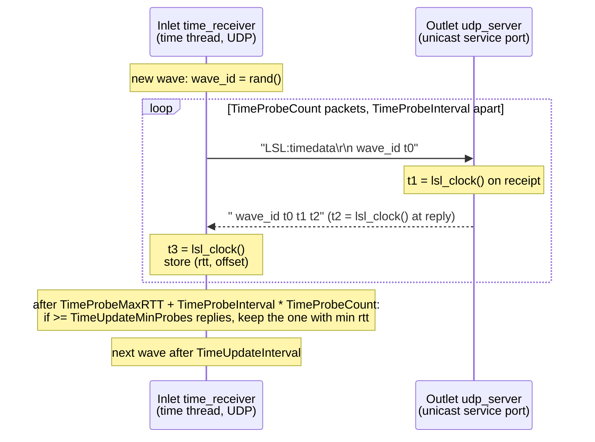

# Time synchronization

Every LSL sample carries a timestamp from the clock of the machine that pushed it.
To compare samples from different machines, an inlet must know how far the
remote clock is from its own. This page describes how liblsl measures that
offset and how the inlet can apply it for you.

For the background (why LSL works this way, how recorders and XDF importers use
the offsets, and validation results), see {doc}`lsl:info/time_synchronization`.

## The local clock

`lsl_local_clock()` (C) and `lsl::local_clock()` (C++) return the current time
in seconds as a `double`. The same value is used internally as `lsl_clock()`.

The implementation is the same on every platform: `src/common.cpp` (functions
`lsl_local_clock_ns` and `lsl_local_clock`) reads `std::chrono::steady_clock`.
`steady_clock` is a monotonic clock: it never jumps backwards and is not
adjusted by NTP or by the user changing the time of day. The C++ standard
library maps it to the platform's monotonic counter (for example
`QueryPerformanceCounter` on Windows, `CLOCK_MONOTONIC` on Linux).

Two consequences follow:

- The zero point is arbitrary (often the time the machine booted). The value
  says nothing about the time of day.
- Clocks on two machines have unrelated zero points and drift slowly against
  each other. Comparing them needs the offset measurement below.

The nanosecond count is split into whole seconds and a remainder as integers
before converting to `double`, so large uptimes do not lose sub-microsecond
precision.

## Who does what

- **Outlet side.** Each outlet runs a unicast UDP server on a free port in
  the range starting at `BasePort` (`src/udp_server.cpp`). Besides answering
  `LSL:shortinfo` discovery queries, it answers time probes (`LSL:timedata`).
  The multicast/broadcast responders on port 16571 do *not* answer time probes;
  their time service is disabled.
- **Inlet side.** Each inlet owns a `time_receiver` (`src/time_receiver.cpp`).
  It opens one UDP socket and sends probes to the outlet's unicast UDP port.
  It sends and receives on that same socket.

The `time_receiver` thread does not exist until the first call to
`time_correction()`, either by your code or by the `proc_clocksync`
post-processing option. Once started, it keeps measuring until the inlet is
destroyed.

## The probe exchange

One measurement round (a "wave") is a short burst of probe packets. Each wave
gets a random `wave_id` so that late replies from an earlier wave are ignored.

1. The inlet sends a datagram with the text `LSL:timedata\r\n<wave_id> <t0>\r\n`,
   where `t0` is its local clock when building the packet
   (`time_receiver::send_next_packet`).
2. The outlet's UDP server takes `t1` from its own clock as soon as the packet
   is received, before parsing it (`udp_server::handle_receive_outcome`).
3. It replies with ` <wave_id> <t0> <t1> <t2>`, where `t2` is its clock when
   building the reply (`udp_server::process_timedata_request`). The reply has
   no method header; it starts with the wave id.
4. The inlet reads its clock as `t3` on receipt
   (`time_receiver::handle_receive_outcome`). Replies with a different
   `wave_id` are dropped.

So `t0` and `t3` come from the inlet's clock, and `t1` and `t2` from the
outlet's clock. All numbers are sent as text with 16 significant digits.

For each reply the inlet computes:

```text
rtt    = (t3 - t0) - (t2 - t1)          # round-trip time minus outlet's processing time
offset = ((t1 - t0) + (t2 - t3)) / 2    # outlet clock minus inlet clock
```

It also stores the midpoints `(t0 + t3) / 2` (local) and `(t1 + t2) / 2`
(remote) of that probe.

The offset formula assumes the trip there and the trip back take equally
long. If they do not, the result is off by half the difference.



## Choosing the estimate

`time_receiver::start_time_estimation` starts a wave and sets two timers:

- **Aggregation**, after `TimeProbeMaxRTT + TimeProbeInterval * TimeProbeCount`
  seconds (0.128 + 0.064 × 8 = 0.64 s with defaults). Then
  `time_receiver::result_aggregation_scheduled` looks at the replies collected
  so far.
- **Next wave**, after `TimeUpdateInterval` seconds (2 s by default),
  measured from the start of the current wave.

At aggregation time:

- If fewer than `TimeUpdateMinProbes` replies arrived, the wave is discarded.
  The previous estimate (if any) stays in place.
- Otherwise the reply with the **smallest RTT** wins, as in the NTP clock
  filter. A small RTT means the packets were least delayed, so the offset is
  least affected by queueing. The inlet then stores:
  - the time correction = minus that reply's `offset` (inlet clock minus outlet
    clock, the value you *add* to a remote timestamp);
  - the uncertainty = that reply's `rtt`;
  - the remote time = that reply's remote midpoint `(t1 + t2) / 2`.

`TimeProbeMaxRTT` is not a filter. No reply is rejected for its RTT. It only
sets how long the inlet waits for replies before aggregating. Replies that
arrive after aggregation are not used.

## `time_correction()`

C: `lsl_time_correction(in, timeout, &ec)` and
`lsl_time_correction_ex(in, &remote_time, &uncertainty, timeout, &ec)`.
C++: `stream_inlet::time_correction(timeout)` and
`time_correction(&remote_time, &uncertainty, timeout)`.
The work is done in `time_receiver::time_correction`.

- **Return value.** The latest stored correction, in seconds. Add it to a
  timestamp from the outlet's clock to map it into the inlet's clock.
- **`remote_time`** is the outlet clock at the chosen probe. **`uncertainty`**
  is that probe's RTT (an upper bound on the error). Collecting
  `(remote_time, correction)` pairs over time lets you fit the clock drift.
- **First call.** It starts the time thread and waits until the first wave
  is aggregated. With defaults that is about 0.64 s on a working network.
  Later calls return the stored value at once; the thread keeps updating it in
  the background.
- **Timeout.** The timeout only applies while no estimate exists yet. If it
  expires, the call fails with a timeout error (`timeout_error` in C++,
  `lsl_timeout_error` in C). `LSL_FOREVER` / `lsl::FOREVER` waits without
  limit. The C++ wrapper in `include/lsl_cpp.h` defaults to `FOREVER`.
- **Lost stream.** If the connection is lost, the call fails with a lost error.
- **Recovery.** When a recoverable inlet reconnects (possibly to a restarted
  outlet), the stored estimate is cleared
  (`time_receiver::reset_timeoffset_on_recovery`). The next call waits for a
  fresh wave. `stream_inlet::was_clock_reset()` (`lsl_was_clock_reset` in C)
  reports that this happened.
  The flag is cleared when read, and `proc_clocksync` reads it too.

## Post-processing

By default an inlet returns timestamps exactly as the outlet sent them. Calling
`set_postprocessing(flags)` (`lsl_set_postprocessing` in C) makes the inlet
rewrite each timestamp as it is pulled (`src/time_postprocessor.cpp`, function
`time_postprocessor::process_internal`). Once enabled, the original timestamps
cannot be recovered. The C++ method defaults to `post_ALL`.

The steps run in this order, each one only if its flag is set:

**`proc_clocksync` (1).** Adds the time correction to every timestamp. The
inlet does not call `time_correction()` for every sample. It re-queries at
most every 0.5 s and only after more than 50 samples since the last query.
The first sample always triggers a query. The query is hard-coded in
`src/stream_inlet_impl.h` (the `stream_inlet_impl` constructor) as
`time_receiver_.time_correction(5)`, a **5 second timeout**. It does not use
the timeout of your pull call. If the outlet clock was reset (see
Recovery above), the offset is fetched again and the dejitter and monotonize
states are reset.

**`proc_dejitter` (2).** Smooths the timestamps of regularly sampled streams.
It is a first-order recursive least squares (RLS) filter
(`postproc_dejitterer::dejitter`). It fits a straight line
`timestamp = intercept + slope × sample_index` through all samples seen so
far and returns the value on that line for the current sample.
In plain words:

- Older samples count less. The forgetting factor is
  `2^(-1 / (srate × halftime))`, so a sample `halftime` seconds old has half
  the weight of the newest one.
- `halftime` defaults to `SmoothingHalftime` (90 s). Change it per inlet with
  `smoothing_halftime()` (`lsl_smoothing_halftime` in C). It takes effect when
  the filter is next initialized.
- The slope starts at `1 / srate`, the nominal sample interval.
- The filter starts on the first sample. It subtracts the whole seconds of that
  first timestamp to keep the arithmetic precise.
- Samples dropped by `flush()` are counted, so the sample index stays correct.
- Streams with an irregular rate (`srate` = 0) pass through unchanged.

The filter needs time to settle; the public header says 30–120 s until the
remaining jitter stays below 1 ms.

**`proc_monotonize` (4).** If a timestamp is smaller than the previous one,
it is replaced by the previous one, so timestamps never go backwards.

**`proc_threadsafe` (8).** Wraps the processing in a mutex, so several threads
may pull from the same inlet.

`proc_ALL` (15) enables all four. Changing the flags resets the dejitter
and monotonize states when those flags change.

## Configuration

These keys live in the `[tuning]` section of the config file. See
[configuration](../guide/configuration.md) for where config files are read
from. Defaults come from `src/api_config.cpp`.

| Key | Default | Meaning |
|---|---|---|
| `TimeProbeCount` | 8 | Probe packets sent per wave. |
| `TimeProbeInterval` | 0.064 s | Delay between probe packets in a wave. |
| `TimeProbeMaxRTT` | 0.128 s | Extra wait after the last probe before aggregating. Not an RTT filter. |
| `TimeUpdateInterval` | 2.0 s | Time between the starts of two waves. |
| `TimeUpdateMinProbes` | 6 | Replies needed for a wave to produce an estimate. |
| `SmoothingHalftime` | 90 s | Default half-life of the dejitter filter's sample weights. |

The outlet's unicast UDP port (and thus the time service port) comes from
`BasePort` (16572) and `PortRange` (32) in the `[ports]` section.

## Practical limits

- **Blocked UDP.** Time probes need UDP in both directions between the
  inlet and the outlet's unicast service port. Data uses TCP, so a stream can
  deliver samples while every probe is lost. Then:
  - `time_correction()` never gets an estimate. It fails after its timeout, or
    blocks forever with `FOREVER`.
  - With `proc_clocksync`, the first pulled sample blocks for up to 5 s and the
    pull then fails with a timeout error. Because no query succeeds, the next
    sample tries again, so every pull can stall for 5 s.
  - A recorder stores no clock offsets for that stream.
- **Packet loss.** If more than `TimeProbeCount - TimeUpdateMinProbes` probes
  (2 by default) of a wave are lost, that wave is discarded. The last good
  estimate stays in use and can grow stale.
- **Asymmetric paths.** The offset is biased by half the difference between
  the outbound and return delays. The min-RTT choice reduces random delay but
  cannot remove a constant asymmetry.
- **Wireless and busy networks.** The uncertainty (RTT) is typically about
  0.2 ms on wired and about 2 ms on wireless networks, per the API docs, and
  can be much higher on poor networks.
